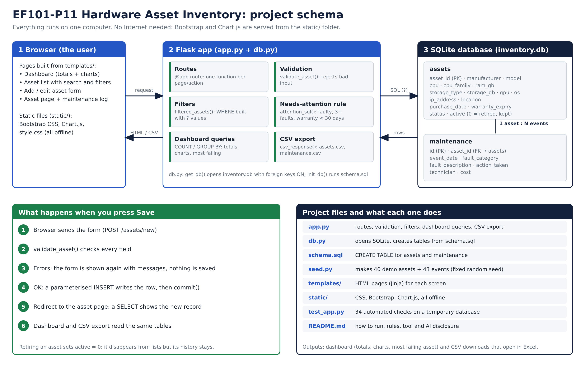

# EF101-P11: Computer Hardware Inventory and Maintenance System

Flask + SQLite web app that tracks computer assets (specs, location, warranty, status) and their maintenance/fault history, with a dashboard and CSV export. All data in `inventory.db` is **DEMO data**, not real assets.

## Project schema


## Run
```
pip install flask
python seed.py        # optional: wipes and recreates inventory.db with demo data
python app.py         # open http://127.0.0.1:5000
python test_app.py    # runs 34 checks on a temporary database, prints a results table
```
No Internet is needed: Bootstrap and Chart.js are served from `static/`.

## Files
| File | Purpose |
|---|---|
| `app.py` | Routes, validation, filters, dashboard queries, CSV export |
| `db.py` | SQLite connection + schema creation |
| `schema.sql` | `assets` and `maintenance` tables (1 asset : many events) |
| `seed.py` | Demo data generator (fixed random seed, reproducible) |
| `test_app.py` | Test evidence (add, edit, retire, invalid input, duplicates, filters, history, dashboard, export) |
| `templates/`, `static/` | HTML (Jinja) pages, CSS, local Bootstrap/Chart.js |

## Rules to document in the report
- **Needs attention** (active assets only): status is Faulty or Under Repair, OR 3+ maintenance events, OR warranty expires within 30 days. Constants `ATTENTION_FAULT_COUNT` and `WARRANTY_SOON_DAYS` are at the top of `app.py`.
- **Warranty status** is computed from `warranty_expiry` (Active / Expiring soon / Expired), never stored.
- **Retire** sets `active = 0`; the row and its history are kept. Reactivate reverses it.
- **Validation**: required fields, RAM/storage positive integers, valid IP, valid dates, purchase date not in the future, warranty not before purchase, duplicate asset ID rejected, event cost >= 0.
- All SQL uses `?` placeholders (no string-built values), so search input cannot inject SQL.

## Tool and AI disclosure (edit before submitting)
Built with Python, Flask, SQLite, Bootstrap, Chart.js. Code was drafted with help from Claude (Anthropic) and reviewed, tested and understood by all team members. List exactly which parts and what each member changed.

## Limitations
No login or user roles; data entry is manual; SQLite suits one site and few concurrent users; demo data is synthetic.
