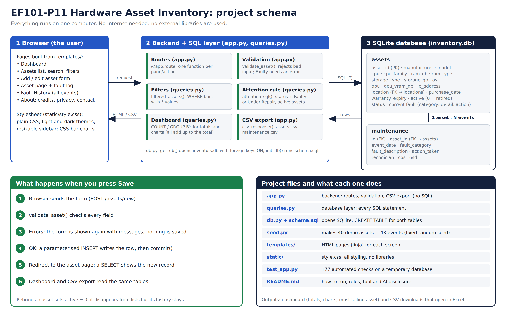

# EF101-P11 Computer Hardware Inventory and Maintenance System

Flask + SQLite web app that tracks computer assets (specs, location, warranty, status) and their maintenance/fault history, with a dashboard and CSV export. All data in `inventory.db` is **DEMO data**, not real assets.

## Project schema

## Run
**Two-click launch** (installs Python and the packages first if they are missing; needs internet the first time):

| | Start the app | Reset to demo data |
|---|---|---|
| Windows | `start.bat` | `reset-demo-data.bat` |
| macOS | `start.command` | `reset-demo-data.command` |
| Fedora / Ubuntu | `start.sh` | `reset-demo-data.sh` |

Double-click the file (Linux: if your file manager only opens it in an editor, run `./start.sh` in a terminal, or set the file manager to "Run in terminal"). The app opens in your browser. If a copy lost its executable bit, run `chmod +x *.command *.sh scripts/*.sh` once.

What the launcher does: finds Python 3.8+ (installs it with winget/python.org on Windows, Homebrew/python.org on macOS, dnf on Fedora, apt on Ubuntu), creates `venv/`, installs `requirements.txt` into it, then starts `app.py`. Later launches skip every step that is already done. `venv/` can be deleted at any time; it is rebuilt automatically. Manual run: `python app.py` still works if Flask is installed.

**Reset to demo data** asks you to type YES, saves the current data as `inventory.before-reset-<date>.db`, then does the same as `python seed.py`.
The app prints its address (http://127.0.0.1:5000, or the next free port if 5000 is busy) and the location of its data file.

- **Your data is kept in this folder**, in `inventory.db`. Launching never deletes it. To move the project, move the whole folder, data included.
- **First launch:** an empty database is created with the six standard places. Add assets from the app.
- **Demo data (optional):** `python seed.py` replaces the data with 40 demo assets. It asks you to type YES first when there is data.
- **Several copies at once:** each copy has its own data file and its own address, so you can run an older version (for example v7) next to this one to compare.
- **Tests:** `python test_app.py` runs every check on a temporary database and prints a results table.

## Files
| File | Purpose |
|---|---|
| `start.*`, `reset-demo-data.*`, `scripts/` | Launchers per OS: dependency check/install, venv, start, demo reset |
| `requirements.txt` | Python packages (Flask) |
| `app.py` | Backend: routes, input validation, CSV export (no SQL) |
| `queries.py` | Database layer: every SQL statement (filters, saves, dashboard figures) |
| `db.py` | SQLite connection + schema creation |
| `schema.sql` | The four tables: `locations`, `assets`, `fault_steps` (steps of an open fault) and `maintenance` (history) |
| `seed.py` | Demo data generator (fixed random seed, reproducible) |
| `migrate.py` | Upgrades an older `inventory.db` to the current version without losing data (backup kept, safe to run twice) |
| `CHANGELOG.md` | What changed in each version |
| `test_app.py` | Test evidence (add, edit, retire, invalid input, duplicates, filters, history, dashboard, export) |
| `templates/`, `static/` | HTML (Jinja) pages and the stylesheet |

## Upgrading an existing database
Only needed if you already have an `inventory.db` from an older version. This version ships with its own up-to-date `inventory.db`, so a fresh copy needs nothing.

Run `python migrate.py` once (or `python migrate.py path/to/inventory.db`). It keeps a backup as `inventory.db.bak` first, checks the new database (row counts, integrity, foreign keys) before replacing the old one, and does nothing if the database is already up to date (running it twice is safe).
- **From version 14-15.x** (the database already has `fault_steps`): everything is kept exactly as it is: assets, places and their range numbers, IP addresses, history, and the steps of open faults. The only change is that steps no longer carry a cost. The cost of an open fault stays on the asset as its single Updated Cost (if an open fault had none, the cost of its last step becomes the Updated Cost). Old steps that only held a cost (no action) are removed.
- **From version 8-13** (no `fault_steps` table): incomplete history entries (a blank or Unknown field) are removed, valid entries logged while a fault was open become its steps, invalid or repeated IP addresses are left as Not Assigned, and everything removed or changed is listed on screen.

## Rules to document in the report
- **Cost**: A single *Updated Cost* ($) box is used across all forms. Rather than adding up a price for every step, the person entering data controls the current total directly. When a fault is closed to Operational, the final maintenance history entry records this Updated Cost. A typed `0` is a real cost of 0 and is saved as 0 (on the Edit form and on the Log form); a blank box keeps the current total.
- **Editable records**: To fix grammatical mistakes or typos, all items in *Maintenance history*, *Current fault*, and open fault steps can be edited directly.
- **Asset IDs**: Auto-generated from the chosen location (e.g. `L1-PC-041`) if not manually entered. The user can enter a custom Asset ID or simply select the place to have the next available ID assigned automatically.
- **GPU VRAM**: The GPU VRAM input is dynamically displayed only when a dedicated GPU is entered. For machines with integrated graphics (blank GPU), the VRAM field is hidden.
- **Fault history page** (sidebar: Fault History): lists every closed fault of every asset, newest first by default. Click a column heading to sort by it (click again to reverse); the Status heading cycles which status comes first.
- **IP addresses**: optional. A blank IP is shown as Not Assigned; nothing is assigned automatically. Two PCs in the same place can never share an IP (a PC's IP is checked against the others in its place); different places may share one.
- **Needs attention** (active assets only): status is Faulty or Under Repair, and nothing else. Past fault events are listed separately on the Fault History page, whatever the status.
- **Current fault**: while a PC is Faulty or Under Repair, its fault (category, description, actions to be taken, technician, date, updated cost) is shown in its Current fault section. Nothing is written to the history while the fault is open. Under Repair requires a technician. A blank category is saved as Unknown.
- **Steps of an open fault**: each save with a new action adds an audit step (its date, action and technician). A step has no cost of its own: the cost of the open fault is the single Updated Cost, so correcting the cost changes the total and adds no step. The steps are listed under Current fault.
- **Closing a fault**: the PC is closed by setting it to Operational. Every fault field (category other than Unknown, description, action taken, technician) and the date are required; the cost is optional. The fault is then written to the history as ONE entry: its Action taken lists every step with its date, and its cost is the single Updated Cost.
- **Sorting**: the asset list sorts by any column (click a heading; click again to reverse). The Status heading cycles which status comes first: Operational (green), Under Repair (yellow), Faulty (red); the other statuses follow alphabetically. The default is Asset ID, ascending.
- **Fault categories**: maintenance events use a fixed drop-down (Disk failure, Overheating, Network issue, RAM fault, OS corruption, Display issue, PSU failure, Other, Unknown). The failure chart always shows every category; anything unexpected is counted as Other.
- **Locations**: a place is chosen from a drop-down, or added with **+ Add new location** (it then appears on the dashboard, even while empty). Each place has a short code (for example Lab 4 = `L4`).
- **RAM type**: DDR1 to DDR5 drop-down, required for every asset (12th to 14th gen Intel CPUs can take DDR4 or DDR5, so the type is recorded per machine).
- **Dashboard charts** are computed from the same active-asset query as the totals, so the charts always add up to the total.
- **Warranty label**: `WARRANTY_SOON_DAYS` (30) at the top of `queries.py` sets the Expiring soon window.
- **Warranty status** is computed from `warranty_expiry` (Active / Expiring soon / Expired), never stored.
- **Retire** sets `active = 0`; the row and its history are kept. Reactivate reverses it.
- **Validation**: required fields, RAM/storage positive integers, valid IP, valid dates (always stored as YYYY-MM-DD, whatever format was typed), purchase date not in the future, warranty not before purchase, duplicate asset ID rejected (upper/lower case ignored), asset ID of letters, digits, `-` `.` `_` only (max 40), costs finite and between 0 and 1,000,000,000, a text box holds at most 500 characters, a location name at most 40.
- **Local-only protections**: the app answers only to `127.0.0.1` / `localhost` (set `INVENTORY_ALLOWED_HOSTS` to add a name), refuses form posts sent from another website, and sends a Content-Security-Policy so the browser loads nothing from the internet. Debug mode is off; start with `FLASK_DEBUG=1` only when developing.
- **Exports**: CSV cells that start with `=` `+` `-` `@` get a leading apostrophe so Excel/Calc cannot run them as formulas; files carry a UTF-8 byte-order mark so accents open correctly.
- **Old databases**: starting the app on an `inventory.db` from an older version stops with a message to run `python migrate.py`.
- All SQL uses `?` placeholders (no string-built values), so search input cannot inject SQL.

## Tool and AI disclosure (edit before submitting)
Built with Python, Flask, SQLite, Jinja templates and plain CSS. Code was drafted with help from Claude (Anthropic) and reviewed, tested and understood by all team members. List exactly which parts and what each member changed.

## Limitations
No login or user roles; data entry is manual; SQLite suits one site and few concurrent users; demo data is synthetic.
